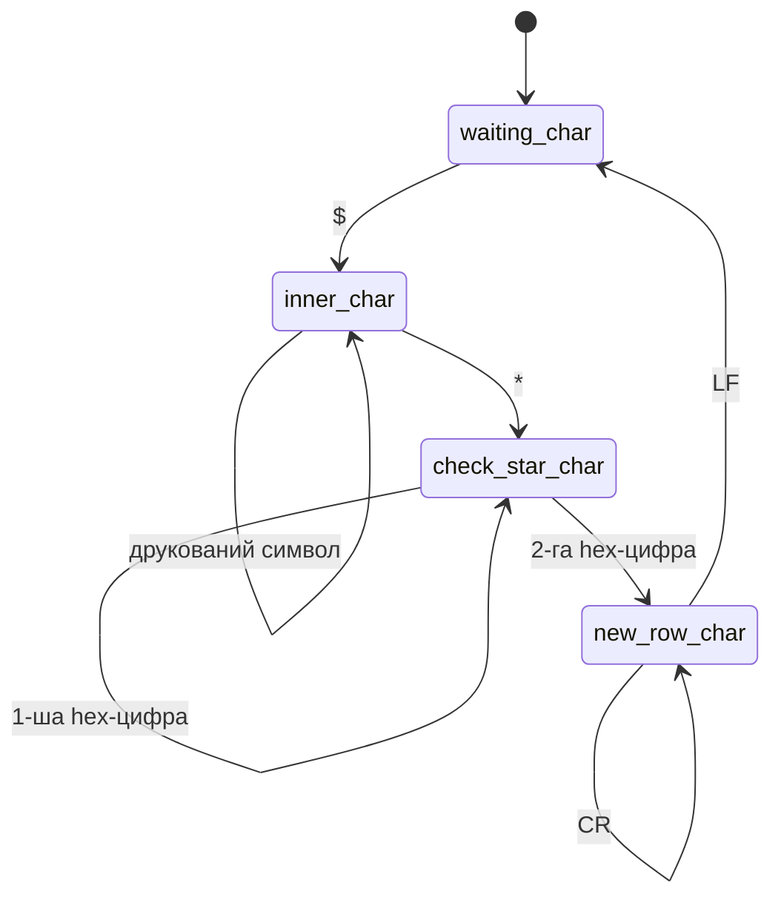

# NMEA-парсер

Побайтовий парсер протоколу NMEA 0183 для модуля Sensor Fusion Core. Приймає потік байтів від GNSS-приймача (з файлу логу або з UART), виділяє з нього окремі речення і перевіряє їхню контрольну суму.

Парсер не виділяє динамічну пам'ять і не кидає винятків, тому той самий код придатний і для настільних платформ, і для мікроконтролерів.

## Формат NMEA 0183

GNSS-приймач передає результати текстовими реченнями ASCII, зазвичай з частотою 1–10 Гц. Приклад:

```
$GPGGA,123519,4807.038,N,01131.000,E,1,08,0.9,545.4,M,46.9,M,,*47
```

| Частина | Значення |
|---|---|
| `$` | початок речення; кожне речення починається з `$` |
| `GP` | talker ID — джерело даних |
| `GGA` | тип речення |
| `,` | роздільник полів |
| `*47` | контрольна сума |
| `\r\n` | кінець речення |

### Talker ID

| ID | Система |
|---|---|
| `GP` | GPS |
| `GL` | ГЛОНАСС |
| `GA` | Galileo |
| `GB` / `BD` | BeiDou |
| `GN` | комбінований розв'язок кількох систем |

Сучасні приймачі здебільшого надсилають `GN`, тому тип речення слід визначати за останніми трьома символами (`GGA`), а не за повною назвою (`GPGGA`).

### Поля

Поля розділені комами. Поле може бути порожнім (`,,`) — наприклад, коли приймач ще не має фіксу. Це нормальна ситуація, а не помилка формату.

### Контрольна сума

Контрольна сума — це XOR усіх байтів між `$` і `*` (самі `$` і `*` не входять), записаний двома шістнадцятковими цифрами. Наприклад, для `$AB*03`: `'A' ^ 'B'` = `0x41 ^ 0x42` = `0x03`.

XOR виявляє будь-який один пошкоджений символ, але не виявляє перестановку символів, тому після перевірки суми зміст полів все одно потрібно валідувати.

### Довжина

Максимальна довжина речення — 82 символи разом з `$` і `\r\n`.

### Координати

- Широта має формат `ddmm.mmmm`, довгота — `dddmm.mmmm`: градуси, а за ними хвилини.
- `4807.038,N` означає 48° 7.038′, тобто 48 + 7.038 / 60 = 48.1173°.
- `S` (південь) і `W` (захід) дають знак мінус.

## Як працює парсер

Клас `NmeaParser` — скінченний автомат. Кожен виклик `receive_byte` обробляє рівно один байт і, залежно від поточного стану, переходить в інший стан.



| Стан | Що відбувається |
|---|---|
| `waiting_char` | очікування `$`; усі інші байти ігноруються |
| `inner_char` | символи записуються в буфер, контрольна сума оновлюється через XOR |
| `check_star_char` | читаються дві hex-цифри очікуваної контрольної суми |
| `new_row_char` | `\r` пропускається; на `\n` обчислена сума порівнюється з очікуваною |

Додаткові правила:

- `$` у будь-якому стані починає нове речення: буфер і сума обнуляються.
- Будь-яка помилка повертає автомат у `waiting_char`: переповнення буфера, недрукований символ у тілі, не-hex символ після `*`, сторонній символ після контрольної суми, `\r` або `\n` у тілі без `*`.
- Підтримуються обидва варіанти кінця рядка: `\r\n` і `\n`.
- Hex-цифри контрольної суми приймаються як великими, так і малими літерами.

## Використання

```cpp
#include "nmea_parser.hpp"

NmeaParser parser;

for (char c : data) {
    if (parser.receive_byte(static_cast<unsigned char>(c))) {
        std::string_view sentence = parser.get_buffer();
        // sentence містить символи між $ і *, наприклад:
        // GPGGA,123519,4807.038,N,01131.000,E,1,08,0.9,545.4,M,46.9,M,,
    }
}
```

### API

| Метод | Опис |
|---|---|
| `bool receive_byte(unsigned char el)` | обробляє один байт; повертає `true`, якщо цей байт завершив речення з правильною контрольною сумою |
| `std::string_view get_buffer() const` | повертає останнє зібране речення без `$`, `*`, контрольної суми і `\r\n` |

`get_buffer()` не копіює дані, а лише вказує на внутрішній буфер парсера. Результат валідний до наступного `$`, після якого буфер почне перезаписуватися. Речення слід розібрати одразу після `true` або явно скопіювати.

## Обмеження

- Парсер лише виділяє речення і перевіряє контрольну суму. Розбір полів (GGA, RMC), перетворення координат і перевірка якості фіксу — наступний крок, який ще в розробці.
- Буфер має 82 байти під дані між `$` і `*`. Оскільки стандартні 82 символи включають ще `$`, `*hh` і `\r\n`, парсер приймає речення трохи довші за стандарт.
- Порожнє речення (`$*00\r\n`) формально проходить перевірку; його відкидає шар розбору полів.

## Тестові приклади

| Вхід | Очікуваний результат |
|---|---|
| `$AB*03\r\n` | `true`, речення `AB` |
| `$GPGGA,123519,4807.038,N,01131.000,E,1,08,0.9,545.4,M,46.9,M,,*47\r\n` | `true` |
| те саме речення з `*48` | `false` |
| `$AB*0G\r\n` | `false` — `G` не hex-цифра |
| `$AB*03\n` | `true` — кінець рядка без `\r` |
| сміття перед `$AB*03\r\n` | `true` — сміття ігнорується |

## Плани

- [ ] Розбір полів речень GGA і RMC у структури
- [ ] Перетворення координат `ddmm.mmmm` → десяткові градуси
- [ ] Фільтрація вимірів за якістю фіксу (0 і 6 — непридатні)
- [ ] Розбір GST для оцінки похибки вимірів
- [ ] Лічильники відкинутих речень за причинами
- [ ] Фазинг-тести
