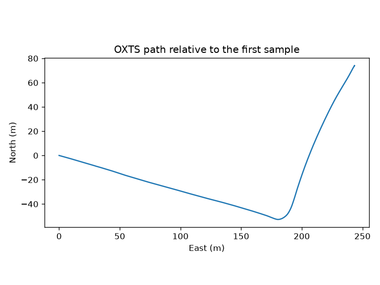
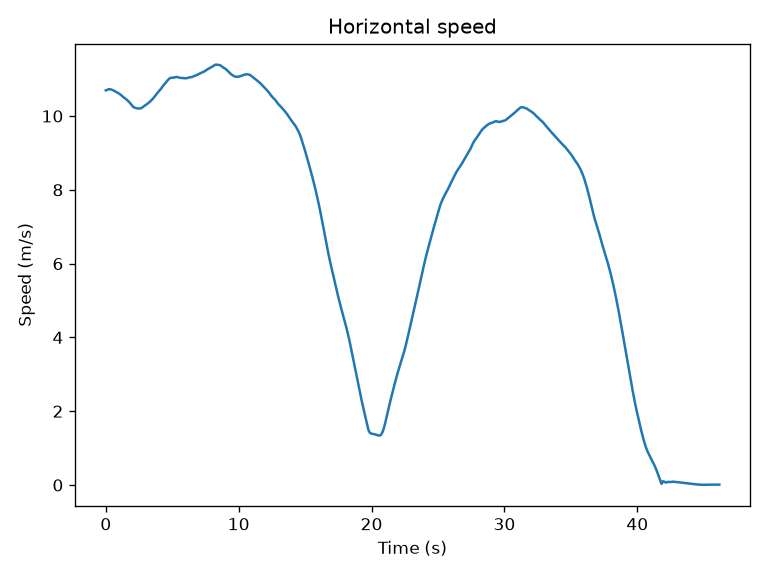
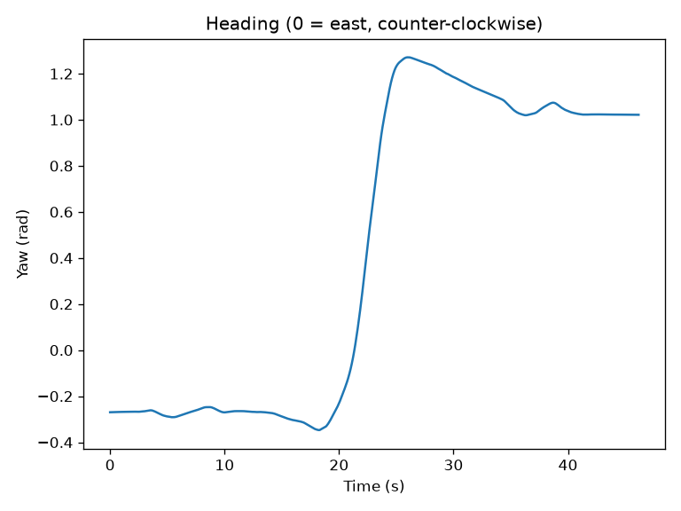
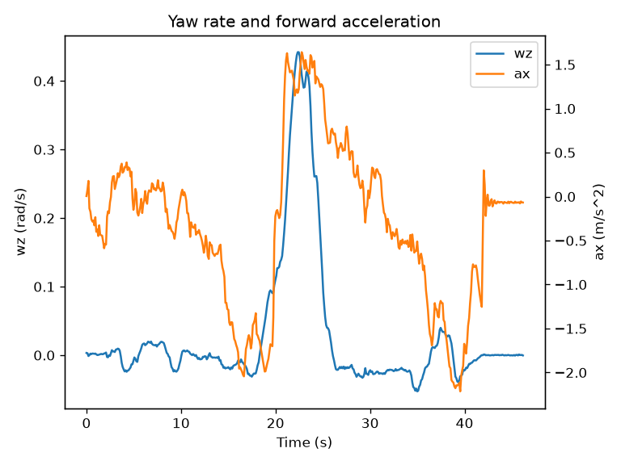

# KITTI dataset survey

## What this data is

KITTI is a public recording of a real car trip. The car carried cameras, a lidar, and a high-grade OXTS unit. OXTS measures where the car is and how it moves: acceleration and rotation.

We only need OXTS. We do not read the cameras, the lidar, or the calibration. The calibration only sits on disk: it describes how the sensors are mounted relative to each other. It is the calibration for `2011_09_26`, shared by the drives from that day.

The recording has no separate cheap GPS. The OXTS position is already high accuracy, so it is the reference. A cheap GNSS will later be an imitation on top of it: the same latitude and longitude will be deliberately spoiled by thinning, noise, and cut-out intervals. We are not building the noise, the gaps, or the filter here. This note only records which fields those later steps will use.

The drive lasts about 46 seconds. That is long enough to cut out 15 seconds without a satellite later, and still leave time before the gap and after it.

## How to get the same files

The download commands are in [data/README.md](../data/README.md). Run them from the repository root to get the same `oxts` folder, without searching the website.

Dataset page: <http://www.cvlibs.net/datasets/kitti/raw_data.php>.

We take one day and one drive:

- the drive, synced variant: <https://s3.eu-central-1.amazonaws.com/avg-kitti/raw_data/2011_09_26_drive_0009/2011_09_26_drive_0009_sync.zip>
- that day's calibration: <https://s3.eu-central-1.amazonaws.com/avg-kitti/raw_data/2011_09_26_calib.zip>

Drive name: `2011_09_26_drive_0009_sync`.

After unpacking, `oxts/data`, `oxts/timestamps.txt`, and `oxts/dataformat.txt` open. The path from `data/kitti` is:

```text
2011_09_26/2011_09_26_drive_0009_sync/oxts/
```

The drive zip is 1,791,264,044 bytes. That is the file size, not a rounded figure from `du`.

These archives are not committed to git.

## How the oxts folder is laid out

`oxts/data` holds 447 files: `0000000000.txt`, `0000000001.txt`, and so on through `0000000446.txt`. Each file is one moment in time and one line of 30 numbers separated by spaces.

`timestamps.txt` also has 447 lines. Line number `i` is the time of the file with the same number. The counts match, and the file numbers have no gaps.

`dataformat.txt` labels these 30 numbers in order. The units in the table below come from that file, with two corrections, because the file itself has typos.

## How to use this later

Whoever writes the KITTI reader does not have to open the archive again. They read the files in `oxts/data` together with the time lines and split each row into roles.

There are three roles.

**Reference** is what the filter is later compared against. That is position, altitude, tilt, heading, and velocity north and east. We trust these numbers.

**Inertial input** is what the filter integrates between satellite updates. That is acceleration `ax`, `ay`, `az` and angular rates `wx`, `wy`, `wz`. The flat model uses `ax` and `wz`.

**Satellite base** is latitude and longitude. The recording has no separate cheap receiver, so these are the fields that get spoiled. The same `lat` and `lon` stay the reference; the spoiled copy will be a second, artificial input.

## Two axis frames

`ax`, `ay`, `az` are the car's own axes: forward, left, and up. If the car tilts, its "up" no longer matches the sky.

`az` is not "the car is accelerating upward." The instrument feels the floor pushing it up, against its weight. On a level road that push points up and is close to 9.8 m/s². This reading is called specific force. On this drive the median `az` is 9.79432 m/s² (from 8.73018 to 10.7596). Until that support is removed from `az`, it is not integrated as upward motion.

`af`, `al`, `au` are the same push, rotated to the horizon: forward along the ground, left along the ground, and up toward the sky. They are not copies of `ax`, `ay`, `az`. The root-mean-square differences are: `ax` and `af` 0.0941646 m/s², `ay` and `al` 0.372361 m/s², `az` and `au` 0.0203001 m/s². The difference comes from the tilt: part of the upward push leaks into the car's forward and sideways axes.

Pitch on this drive is small: from −0.004709 to 0.019803 radians, median 0.008953. That is about one degree. The piece of gravity that this tilt puts into `ax` has a root-mean-square size of 0.0953275 m/s². `ax` itself runs from −2.21396 to 1.64151, with a root-mean-square size of 0.958511. The tilt is a noticeable offset, smaller than speeding up and braking, but the flat model does not throw it away as a trifle. For 2D we still keep `ax` and `wz`. We do not replace them with `af` and `wu`.

`vf` nearly matches the horizontal speed `sqrt(vn² + ve²)`: the root-mean-square difference is 0.0301963 m/s. `wz` nearly matches `wu`: the difference is 0.000543441 rad/s. On this drive those are practically the same numbers, so the table marks `vf` and `wu` as "not used yet."

Axes that are easy to mix up:

- heading `yaw`: 0 means east, and positive is counter-clockwise;
- `ax`, `ay`, `az`: forward, left, and up in the car's axes.

In `dataformat.txt` the third acceleration is labeled `ay` again. That is a typo in the file. The third number is `az`, up in the car's axes. Next to it, `pos_accuracy` is labeled "velocity accuracy," although the unit is meters. That is position accuracy, not velocity accuracy.

| Field | Unit | Role in the project |
| --- | --- | --- |
| `lat` | degrees | reference and satellite base |
| `lon` | degrees | reference and satellite base |
| `alt` | meters | reference |
| `roll` | radians | reference |
| `pitch` | radians | reference |
| `yaw` | radians | reference |
| `vn` | m/s, north | reference |
| `ve` | m/s, east | reference |
| `vf` | m/s, along the ground | not used yet |
| `vl` | m/s, left along the ground | not used yet |
| `vu` | m/s, up from the ground | not used yet |
| `ax` | m/s², forward | inertial input |
| `ay` | m/s², left | inertial input |
| `az` | m/s², up, specific force | inertial input |
| `af` | m/s², forward along the ground | not used yet |
| `al` | m/s², left along the ground | not used yet |
| `au` | m/s², up from the ground | not used yet |
| `wx` | rad/s | inertial input |
| `wy` | rad/s | inertial input |
| `wz` | rad/s | inertial input |
| `wf` | rad/s | not used yet |
| `wl` | rad/s | not used yet |
| `wu` | rad/s | not used yet |
| `pos_accuracy` | meters | not used yet |
| `vel_accuracy` | m/s | not used yet |
| `navstat` | status code | not used yet |
| `numsats` | satellite count | not used yet |
| `posmode` | mode code | not used yet |
| `velmode` | mode code | not used yet |
| `orimode` | mode code | not used yet |

`pos_accuracy`, `numsats`, `posmode`, `velmode`, and `orimode` are not fed to the filter. They only show how far the reference can be trusted.

## How long the drive is, and the time step

The script `tools/kitti_oxts_survey.py` prints the numbers.

- Samples: 447.
- Duration, from the first timestamp to the last: 46.171861679 s.
- Step min / median / max: 0.080027186 / 0.100042541 / 0.110299703 s.

The step is close to 0.1 s, but it is not constant. The shortest step is noticeably below the median. No step is longer than 1.5 times the median.

## How accurate the position is

The typical `pos_accuracy` on this drive is 0.434815 m. The best value is 0.216453 m, the worst is 0.485601 m. The instrument's own estimate of the position error is about 20–50 cm.

Satellites, `numsats`: median 10, from 6 to 13.

`posmode`: mode 4 (differential correction) 285 times, and mode 5 (RTK float) 158 times. `velmode`: mode 4 280 times, and mode 5 163 times.

Four rows in a row, indexes 178–181, have `posmode`, `velmode`, and `orimode` equal to −1. The OXTS mode list has no such number. The rest of those rows is ordinary: `pos_accuracy` about 0.46 m, and 10, 11, 11, and 12 satellites. A row is not dropped because of a single −1 code.

`orimode` is 0 in 352 of 447 samples. Mode 0 means the GPS receiver is not providing orientation. The heading `yaw` is still in the file: the OXTS unit itself provides it, not a separate GPS heading. Mode 6 appears 86 more times, mode 1 appears 5 times, and the same 4 rows are −1.

The OXTS position is already high accuracy, so it is the reference. The recording has no separate cheap GPS. A cheap GNSS will be an imitation on top of these `lat` and `lon`.

## Which stream to read

The downloaded archive is synced, one stream at about 10 times per second. OXTS rows are kept at the moments when the camera took a frame. The measured median step is 0.100042541 s.

The reader takes this stream. Every row is the inertial input. The satellite input is a thinned copy of the same `lat` and `lon`, not a second file. We do not download the full OXTS stream at about 100 Hz, and we do not build it into the reader.

## Figures

The same script draws them. Seeing them does not require downloading the dataset again.

The path is converted to meters from the first point. For a drive this short we treat the Earth as flat, with radius 6,378,137 m. The angles in the formula are in radians:

```text
east  = R * cos(lat0) * (lon - lon0)
north = R * (lat - lat0)
```

East runs from 0 to 243.461 m, north from −52.7362 to 74.1023 m. The figure shows a drive with a turn, not a single point.



Horizontal speed is `sqrt(vn² + ve²)`.





The last figure shows vertical angular rate `wz` and forward acceleration `ax` together. The flat model uses these two series.



## How to recompute the numbers and figures

From the repository root, after the commands in the script header:

```bash
.venv/bin/python tools/kitti_oxts_survey.py
```

With no argument, the script finds this drive's `oxts` folder on its own: the path is built from the repository root, so the current directory does not matter. A path to another `oxts` folder passed as an argument is read from the current directory. The script rewrites the four figures next to this note.
